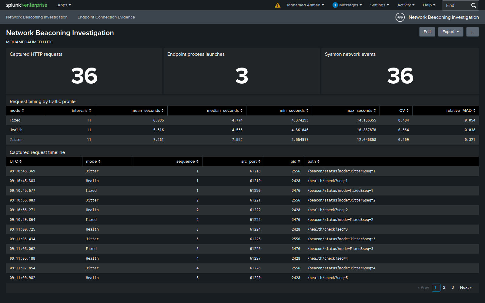
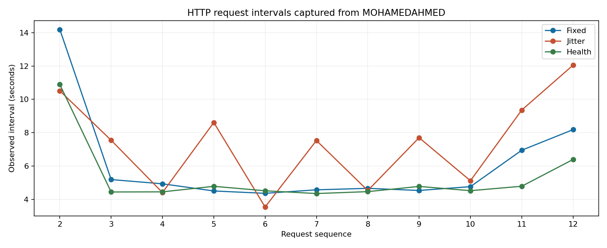
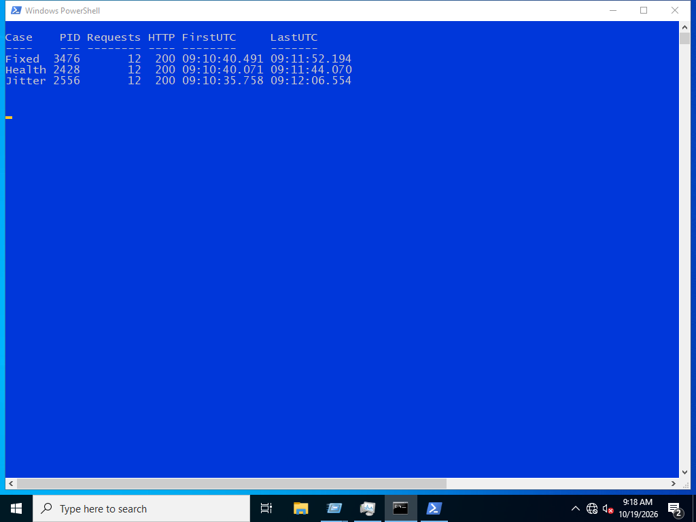
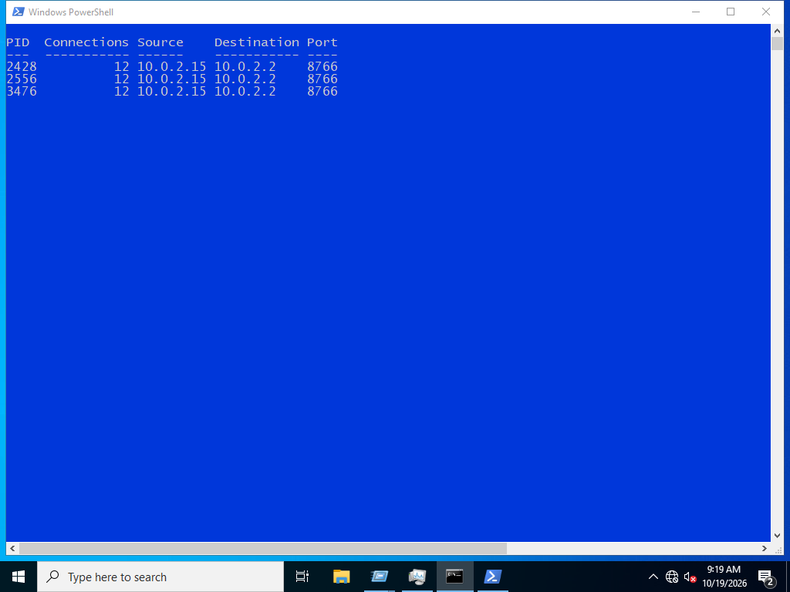

# Network Beaconing Investigation

A Windows traffic lab for investigating recurring HTTP connections. Three traffic profiles are captured in a PCAP, correlated with Sysmon, and compared in Splunk: fixed intervals, varying intervals, and an authorized health check.

## Recorded results

The run produced **36 HTTP requests** from three Windows processes. Each profile sent 12 requests to an internal lab service. **36 requests** were matched to native Sysmon connection records using the original source port.

| Profile | Requests | Mean interval, seconds | CV | Median, seconds | Relative MAD | PID |
| --- | ---: | ---: | ---: | ---: | ---: | ---: |
| Fixed | 12 | 6.085 | 0.484 | 4.774 | 0.054 | 3476 |
| Jitter | 12 | 7.361 | 0.369 | 7.552 | 0.321 | 2556 |
| Health | 12 | 5.316 | 0.364 | 4.533 | 0.038 | 2428 |

The fixed profile and health-check control both have low relative median absolute deviation, despite occasional longer intervals. The CV-only filter misses them in this short capture. The health-check control also repeats regularly. A timing rule can find candidates, but needs endpoint context and the purpose of the destination before an analyst can call the activity command and control.

## Investigation files

- [Investigation and timing method](docs/investigation.md)
- [Build and reproduce](docs/reproduce.md)
- [Packet capture](evidence/network.pcap)
- [Interval measurements](evidence/interval-summary.csv)
- [Evidence index](evidence/README.md)

All three profiles are controlled lab traffic. The service returns a small status response; it does not deliver commands or collect company data.
